# 岐黄图鉴 · 中医知识可视化原型

第一版目标：用样例数据做出**可点击、可旋转、可跳转、可查出处**的原型，不接真数据库。

- 治疗法门篇：看诊十问、治疗法门、治癌法门、脉诊、望诊、听诊、治病先后主次、灸、针。
- 经络图：手太阴肺经已补全 11 穴（中府、云门、天府、侠白、尺泽、孔最、列缺、经渠、太渊、鱼际、少商），每穴标注井/荥/输/经/合、原/络/郄/募/母/子等属性；其余经络显示“收录 x / 标准总数”，按同一格式逐条补全。3D 支持 360° 旋转、缩放、前后视图。
- 本草：9 味样例药材，性味、归经、功效、主治、禁忌，古籍名/现代别名/地域名，3 张实拍照片、配伍关系；照片固定按“全图 / 入药部位图 / 药材高清切片图”三格排列，个别切片图待补，不拿相似图替代；列表页只保留三经与功效分类两套索引，不再平铺全部药卡；点开任一分类可查看该类全部药材。顶部按《神农本草经》三经（上经/中经/下经）与 12 个功效分类做多对多索引，药名互相链接；分类是阅读标签，不是经典原文。列表页另设“药性基础法则”思维导图（三品、四气五味、气味阴阳、升降浮沉、药质部位、配伍七情），悬停预览、点击固定，每支回引《神农本草经》《本草备要》《素问》或《中药学》。另收录倪海厦《神农本草经》讲义 411 条（上经、中经、下经，附倪师补充 27 味与整理者增补 34 味），入口在本草页底部“讲义与课程”区及 `/bencao`；原文、后世注家、讲义归纳、倪师按与课堂讲授分层标注。重复条目已按现代常用名归并（如茈胡→柴胡、芎穷→川芎、蓝实→青黛、石龙刍→龙须草），旧名保留在详情页“古籍名”栏。9 味药典样例与讲义条目去重合并为 409 味索引：三经与 12 个功效分类各显示总数，点开可看该类全部药材，每味再进详情，并在详情页页首互跳三经与功效分类。讲义中 35 味有炮制内容，详情页与 `/processing` 的“讲义炮制摘录”区互相链接；这些炮制文字未经现行规范逐条核对，不与已核条目混为一体。讲义药材卡与药典样例同构：无实拍图时用印章式封面，不伪造照片；药名、拼音、性味、归经、功效与出处徽标齐备。性味优先从讲义原文提取，归经与缺失的功效用公开中药资料补足并单独标注来源；公开资料不足者明确写“归经待考”，不据功效反推。详情页“配伍关系”下有“炮制方法”，与 `/processing` 共用数据。
- 方剂：桂枝汤、小柴胡汤，原文、原文药材选取与煎服法、现代剂量切换、现代煎煮/服用参考、症状、组成、君臣佐使、用量比例、加减、关系图谱、方义解说、历代医家解说栏（预设“古籍条曰”与“历代医家解说”两种占位卡片，原文待补）；君臣佐使用不同颜色和符号区分，原文证据悬停预览/点击查看全文。计量单位标“一两 = 现今的一钱”，组成区先列常用组成配比，用量表默认显示今用剂量，可点“切换古代用量”查看古籍原方用量与比例；方义解说逐味说明该药在方中作用，并汇总主治。小柴胡汤今用配比 5:3:3:5:3:3（柴、芩、参、半、草、姜，大枣另计）。关系图谱悬停药材可看其在方中的作用（如柴胡疏肝胆），作用归纳标为后世方解。原文中带虚线的词可悬停看现代注解；“现代解说”栏未填时显示“待补充”，可点“添加解说”在网页里填写并保存到当前浏览器，或复制生成的数据代码写入 `formulas.mjs` 永久发布。
- 医案：风湿、表证、肠胃、肺篇、心胸、腹篇、积饮病、消渴、水病、痢篇、脓疡、孕妇科、男科、精神。
- 古法锻炼：金刚功、长寿功、五禽戏、易筋经、八段锦等收藏页；视频/图片只收自有、授权或官方公开素材，未收录前标“待收录”。
- 名家讲堂：按“医家 + 课程”收录视频课件，不再拆伤寒论、傅青主女科、本草纲目、千金方等小类。现收倪海厦《针灸大成》8 集（01–07、12），页面直接注明讲授者与课程名；视频文件单独上传服务器，不进 Git。
- 药材的炮制：按草木类、蛇虫类、金石类分栏，已收录 9 味样例药的净制、切制与加辅料炮制；每法回引药典 2020 年版一部【炮制】项，标“摘录”，成品性状与使用注意同页展示。麻黄、露蜂房、牛虻的读者线索单列“待核”，不写成已收录方法。
- 阅读说明：原首页“内容方法论”移入页脚“关于本站”，鼠标悬停或点击打开；说明原文/方解分层、坐标离线预计算与大方向排版规则。
- 医家经典古籍：四部医书全文各自独立——《血证论》《伤寒捷诀》《伤寒论辑义》《石室秘录》。详情页只列作者、序跋、卷次与篇名；点篇名进入该篇原文，序、跋与正文按原书次序排列。另集中展示项目已引用的《伤寒论》《灵枢》《难经》《神农本草经》《本草纲目》等古籍条文，具体条目的出处仍在各内容页旁点击查看。
- 所有中医内容标注出处；原文、摘录、后世方解分开标注；方剂出处写具体古籍（《伤寒论》《金匮要略》或傅青主具体书名），不用“方剂学”代替古籍出处；治疗法门篇与医案目前只立栏目，正文待录。

## 预览

| 首页 | 经络图 |
|---|---|
| 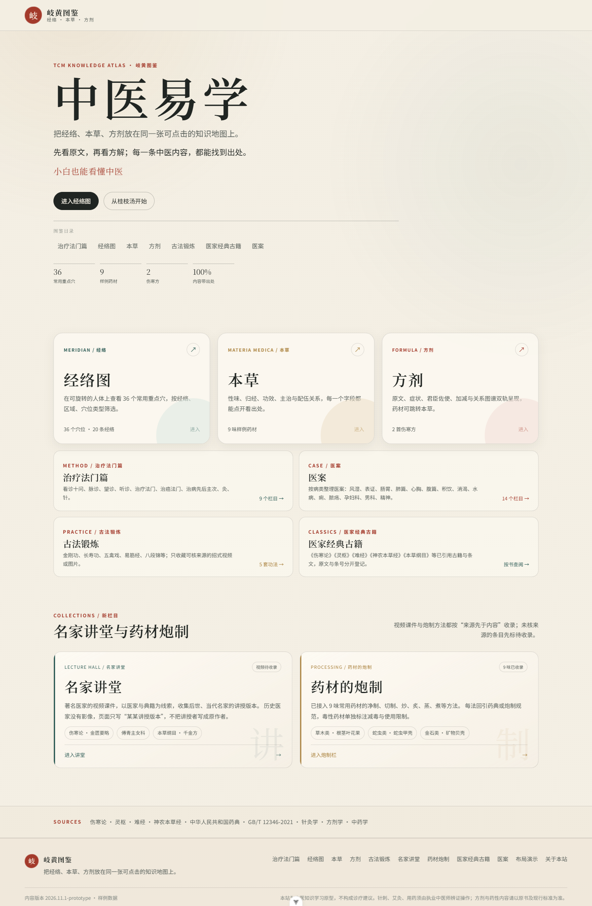 | 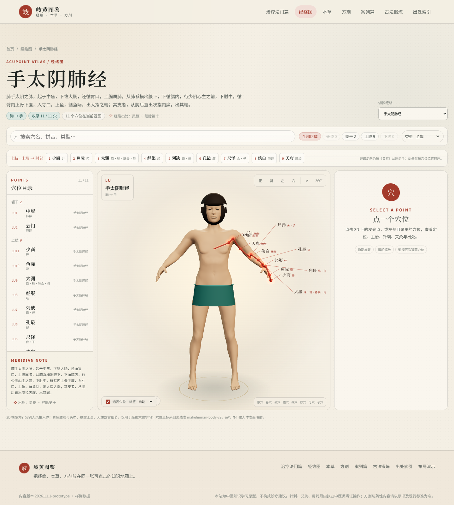 |

| 方剂 | 本草 |
|---|---|
| 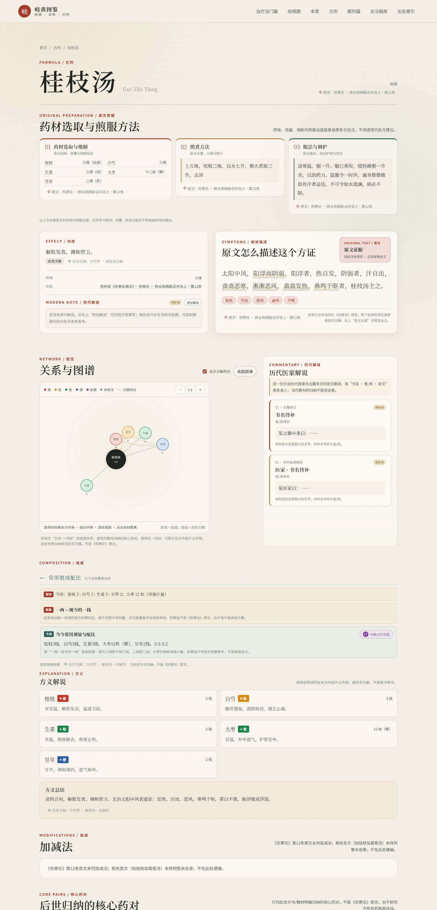 | 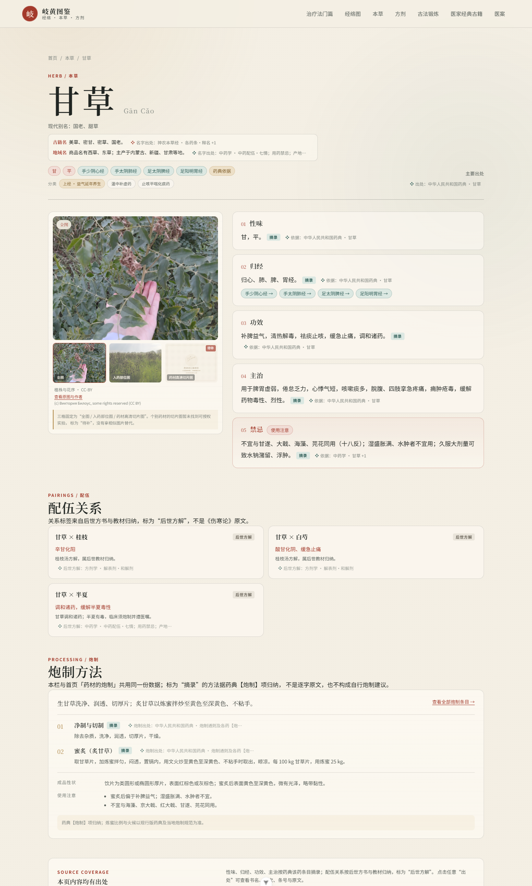 |

| 足少阴肾经 | 全身重点穴 |
|---|---|
| 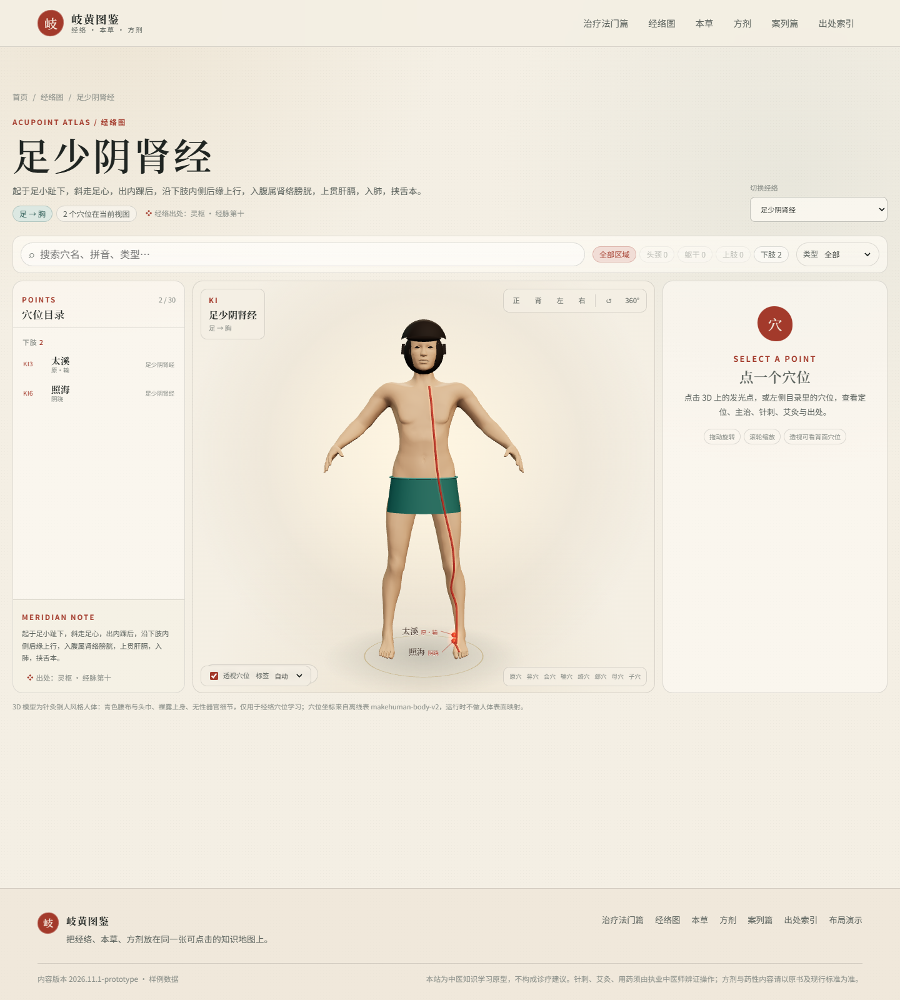 | 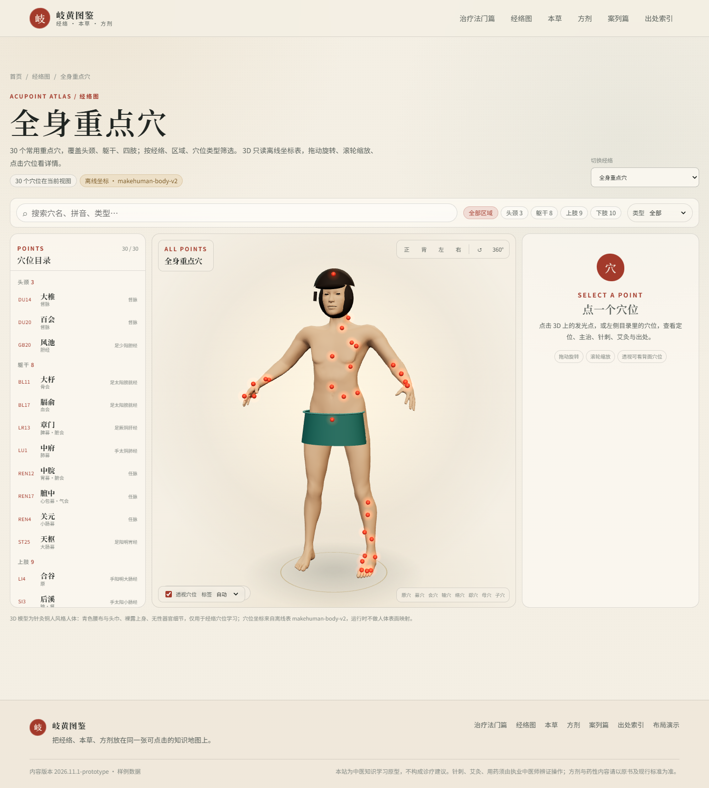 |

| 治疗法门篇 | 医案 |
|---|---|
| 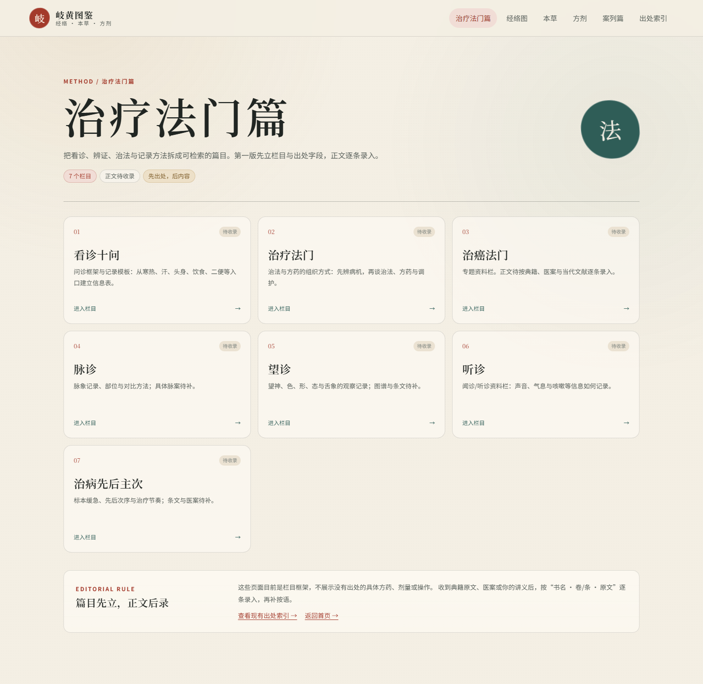 | 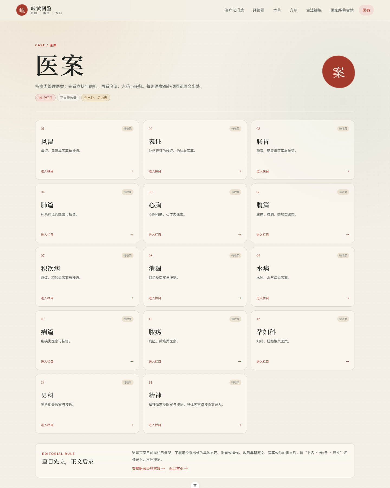 |

| 古法锻炼 |
|---|
| 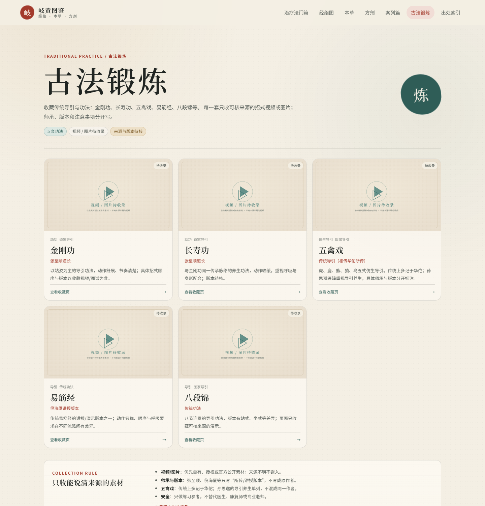 |

| 名家讲堂 | 药材的炮制 |
|---|---|
| 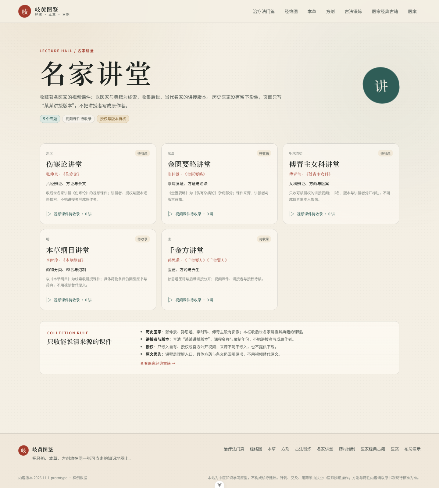 | 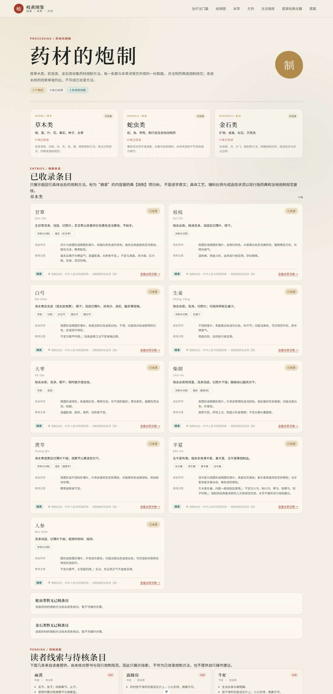 |

| 医家经典古籍 | 全书目录 |
|---|---|
| 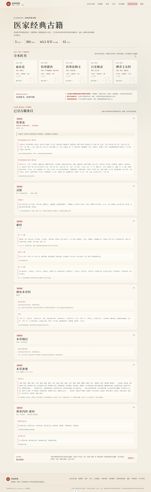 | 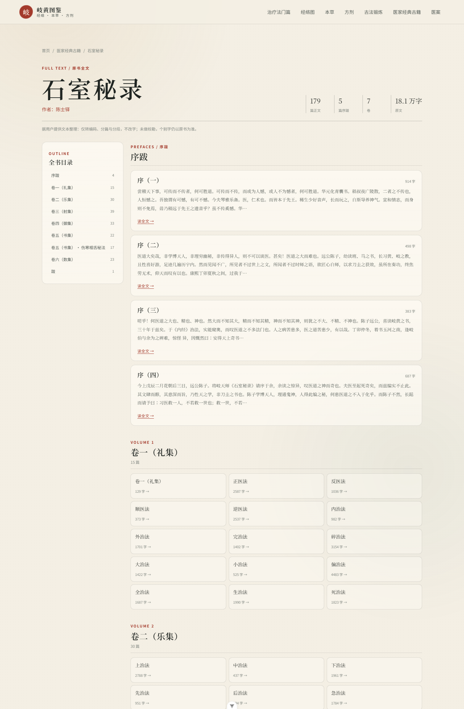 |

## 运行

需要 Node.js 22 或以上。

```powershell
cd E:\code\qihuang-tcm
npm install
npm run dev
```

打开 <http://127.0.0.1:5173/>。

也可以双击 `start.bat`，首次会自动安装依赖。

## 构建

```powershell
npm run build
```

产物在 `dist/`，可以放到任意静态服务器。构建前会自动运行数据校验；出处、引用、坐标或覆盖检查不通过会直接失败。

## 服务器部署

独立 Docker 部署目录见 `deploy/`，当前临时预览：<http://182.255.94.89:8081/>。

- 服务器目录：`/opt/qihuang-tcm`，与 `/opt/xuefeng` 完全独立，不共用 Compose 或 Caddy。
- 发布：`npm run build` 后运行 `deploy/publish.ps1`，或按 `deploy/README.md` 手动上传 `dist/`。
- 80/443 仍由现有 xuefeng 入口占用；本项目当前走 8081，域名与 HTTPS 后加。

## 目录

```text
qihuang-tcm/
├── public/
│   ├── data/sample_data.json      # 全部样例内容与出处
│   ├── data/classics/             # 四部医书的分卷 JSON（按需加载）
│   └── images/herbs/real/         # 27 张实拍照片（iNaturalist，CC 许可）
├── scripts/
│   ├── content/                   # 内容源（sources/herbs/...）
│   ├── content/classics/          # 四部医书的 UTF-8 底本
│   ├── build-sample-data.mjs      # 生成 sample_data.json 与图片
│   ├── build-classics.mjs         # 拆序跋、卷次、篇名与正文
│   └── validate-data.mjs          # 构建前校验
├── src/
│   ├── components/                # 图谱、引用抽屉、3D 人体等
│   ├── views/                     # 首页 / 本草 / 方剂 / 经络 / 出处
│   ├── three/createBody.ts        # 程序化针灸铜人低模
│   └── types/tcm.ts               # 数据类型
├── deploy/                        # 独立 Docker 部署（/opt/qihuang-tcm）
└── docs/                          # 来源说明、资产许可、截图
```

## 内容原则

1. **没有出处的内容不展示。** 每个知识点都带 `citationIds`，校验脚本会检查。
2. **原文、摘录、方解分开。** `quote` 是原文，`paraphrase` 是摘录，`analysis` 是后世方解。
3. **查不到确切出处就不写。** 例如《伤寒论》第 12 条没有桂枝汤加减法，页面就写“原文未列”，不硬编。
4. **不使用运行时 AI 生成中医内容。** 第一版没有大模型接口；以后若加问答，也必须检索已核验数据并强制引用。
5. **3D 坐标离线预计算。** 运行时只读 `sample_data.json` 里的 `[x,y,z]`，不做人体表面映射。

## 数据更新

内容源在 `scripts/content/`：

- `sources.mjs`：出处
- `herbs.mjs`：药材
- `meridians.mjs`：经络
- `acupoints.mjs`：穴位
- `formulas.mjs`：方剂
- `classics.mjs`：四部医书的书名、作者与底本文件
- `classics/*.txt`：四部医书 UTF-8 底本

修改后运行：

```powershell
node scripts/build-sample-data.mjs
npm run validate:data
```

会重新生成 `public/data/sample_data.json` 和 `public/data/classics/*.json`；实拍图片版权见 `docs/PHOTO-CREDITS.md`。

## 方剂布局

| 药味数 | 默认布局 |
|---|---|
| 1～8 | 同心环 / 放射，按君 → 臣 → 佐 → 使从内到外 |
| 9～20 | 分层图谱 + 角色分组列表并排，列表不折叠 |
| 21 以上 | 默认角色分组列表，全部展开，不折叠；图谱可选 |

`/lab/formula-scale` 是 24 味模拟数据的布局演示，**不是真实方剂**。

## 3D 模型说明

- MakeHuman CC0 基础网格改造，男性化；短发、贴身穿青色短裤，无性器官细节，仅用于经络穴位学习。
- `bodyModel.coordinateFrame = makehuman-body-v2`；换模型必须同步重跑坐标预计算。
- 手太阴肺经、足少阴肾经、任脉、督脉有具体示意走向线；其余经络以穴位点为主。
- 3D 模型基于 MakeHuman CC0 基础网格改造；本草实拍图片来自 iNaturalist，逐张许可见 `docs/PHOTO-CREDITS.md`。

## 开发工具

Vite 开发服务器已配置：

- **Vue DevTools**：页面内调试组件与状态；开发服务器启动后按 `Alt+Shift+D` 打开。
- **vite-plugin-checker**：开发时实时运行 `vue-tsc`，类型错误会在编辑器角落弹出，不阻塞预览。
- **rollup-plugin-visualizer**：每次 `npm run build` 生成 `dist/stats.html`，用浏览器打开可看各 chunk 体积；不参与运行时。

OpenCode 桌面端插件（全局配置，不在本项目仓库内）：

- `@tarquinen/opencode-dcp`：上下文压缩，已写入 `~/.config/opencode/opencode.json`。
- `opencode-subagent-statusline`：**只支持终端 TUI**，会在侧栏显示子代理状态，桌面 GUI 不渲染；已从 `cli.json` 移除。需要在终端使用时，再把包名加回 `~/.config/opencode/cli.json` 的 `plugins` 数组并重启 OpenCode。

## 免责声明

本站为中医知识学习原型，不构成诊疗建议。针刺、艾灸、用药须由执业中医师辨证操作；方剂与药性内容请以原书及现行标准为准。
